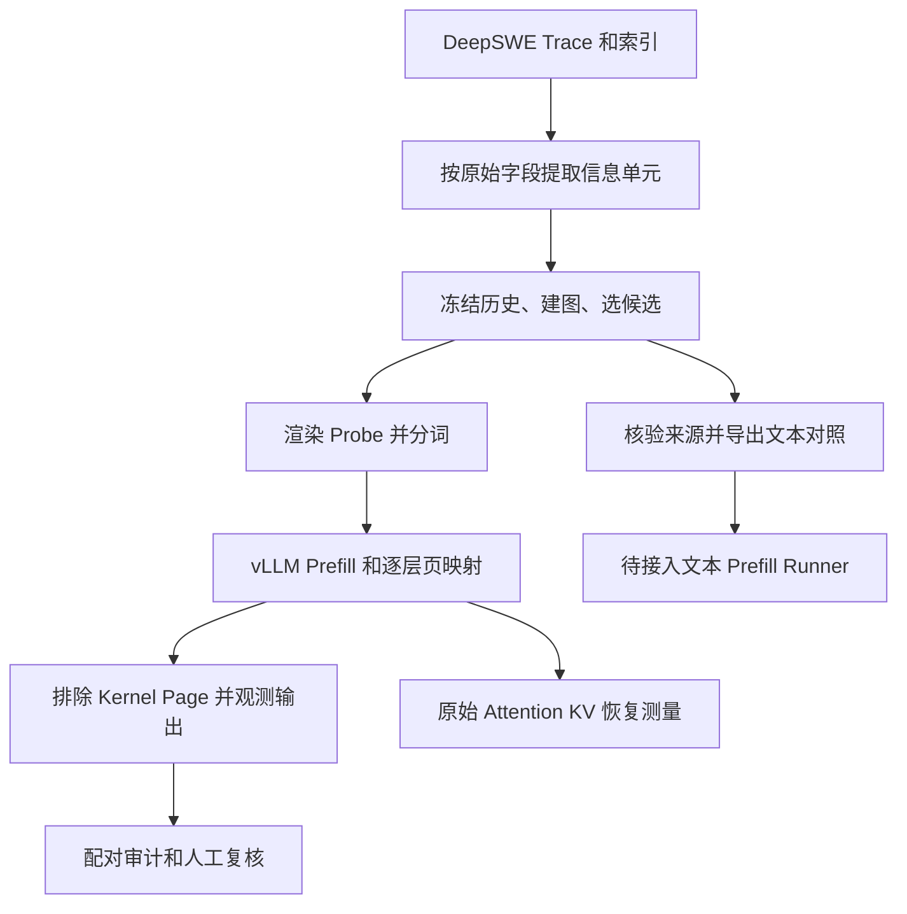

# Text-level Deletion 与 KV-level Deletion 的代码调研

审查基线为 [kvmem/kvmem-vllm 的 main 提交 d1e9d81](https://github.com/kvmem/kvmem-vllm/commit/d1e9d81e3e7186e1285d405aa1eaed6cb519d931)。下文的源码链接均固定到这一提交。Graph Cleanup 的 4090 测量是仓库记录的既有实验。新实验的数据准备、模型推理和显存结论各有独立验收条件。

## 从 Trace 到实验结果

| 环节 | 调用链和证据 |
| --- | --- |
| 读取和切分 Trace | `duokv_observation/core.py::normalize_trace` 读 JSONL 中的 message 和 labels，将 turn 映射到 Step。DeepSWE 根据标签和 JSON Pointer 提取 Thinking、工具输入、工具返回、任务约束等，经 `structural_spans` 切分。每段保存行号、字段、原文字符区间、原文哈希和单元 ID。重试及脚手架有明确过滤规则。 [normalize_trace][normalize] |
| 构图与选样 | `graph_cleanup/prepare.py::run` 校验原字段切片与哈希，扫描 16 任务 × 4 seeds，共 64 条轨迹。在 seed 1001 上按完整 Step 构建前缀。错误样本可使用有左截断标记的窗口。`add_snapshot` 调用 `graph`、`rankings`、`history`，冻结单元和快照，再选六类各四个候选。 [run][prepare] [graph 和 rankings][graph] |
| 图边的含义 | `graph` 用 tool call ID 添加可观察的调用与返回边，用空白归一的等值、5-gram 重叠和实体添加计算边。`rankings` 结合时间、冗余和三轮需求传播。替代关系和删除安全由人工标注填写。 [graph 和 rankings][graph] |
| 文本消融 | `graph_cleanup/audit.py::run` 核验源文件哈希、字段切片、checkpoint、图边及渲染结果。它用 `history` 重渲染 Full 与移除一个完整 `<unit>` 包装和正文的 Reduced，导出 `text-ablation-inputs/`。这些 JSON 已冻结六个问题，可作为文本对照的先例。 [run][textaudit] |
| Probe 和逻辑页 | `gpu_study.py::prepare` 将历史包进同一个 system/user 聊天模板，使用本次模型 tokenizer 返回原始 IDs 和 offset mapping。`protocol.py::token_mapping` 将与单元正文相交的 token 映射为 `position // 32`，区分相交页与完全包含页，并记录共同占用页的单元。这个历史是依据 Trace 制作的重放输入。 [prepare][gpuprep] [token_mapping][tokenmap] |
| 逐层物理映射 | `gpu_worker.py::Measurement.before_model` 读取绝对 position，校验单请求连续以及文本 MRoPE 轴一致。`wrap_attention` 累积该层 `attn_metadata.slot_mapping`，验证槽内偏移及页连续性，将 token 位置映射到 `slot // page_tokens`。Reference/Re-run 的同逻辑页可以占用不同物理 ID，逐层核验发生在各自请求上。 [before_model][positions] [wrap_attention][slots] |
| 配对证据 | `gpu_study.py::run` 运行 native/custom 零删除、重复性、Full/Reduced 和小规模重复。`analyze_gpu.py::analyze` 检查同 prompt IDs、16 层历史 KV 哈希、80 个输出序列及逐 token Probe 坐标，然后输出候选、层、排序、服务和盲审材料。 [run][gpustudy] [analyze][analysis] |

Graph Cleanup 直接调用 DuoKV 的 normalizer。DuoKV 自身的 `run_study.py::main` 还调用 `detect_reuse`，`events.py::observed_events` 与 `supersession_relations` 提供事件及覆盖证据。Agent Execution Observer 则经 `observer.py::prepare/extract_step` 提取 Step，`request_for/replay` 按冻结 Trace 问进度和下一步，`rule_slicing.py::CandidateSlicer`、`structure_slicing.py::StructureAdapter` 可供候选结构审核。第一阶段直接消费已有 Graph 数据和源 Trace，保持原有入选过程。 [DuoKV main][duokv] [DuoKV events][events] [Observer][observer] [Rule Slicer][rules] [Structure Adapter][structure]

日常 KVMem 服务的入口是 `serving/serve.py::build_launch`。它配置 `KVMemScheduler` 和 `KVMemConnector`，后者通过 `get_num_new_matched_tokens`、`update_state_after_alloc` 与 `start_load_kv` 将归档与恢复接入 vLLM 调度和 worker。Graph Cleanup 的离线测量则直接构造原生 vLLM `LLM` 并挂载实验 worker。后续比较要记录实际启用的服务路径，保持同一对内其余设置一致。 [build_launch][launch] [KVMemConnector][connector] [Graph Cleanup 引擎][gpuengine]

## Shadow 路径、状态和释放边界

1. `gpu_study.py::run/arm` 通过 RPC 调用 `CleanupWorkerExtension.cleanup_setup`，随后把完整 prompt IDs 交给 `llm.generate`。该引擎关闭 prefix caching。Full 和 Reduced 各自从位置 0 执行 Prefill。原方案利用相同历史重算和逐层 KV 哈希验证干预前的 Attention KV 一致性。它能做质量与层输出诊断，续跑省去历史 Prefill 需要额外实现与证明。 [arm][arm] [engine 配置][gpuengine]
2. `Measurement.wrap_attention` 在 Probe 边界前保留原生结果。边界处从按逻辑顺序排列的物理页表中排除目标页，用其余页调用 FlashInfer `BatchPrefillWithPagedKVCacheWrapper.plan/run`。Query 和 K 保留原 RoPE 位置，Probe 行替换原输出。后续 decode 只在 KV 写入独立于 Attention 的 backend 上跳过原生 Attention。代码限制 32-token 内核页、FP8 E4M3 布局、24 个 Q heads、4 个 KV heads、head dim 256。 [wrap_attention][mask]
3. Shadow 操作的物理释放为 **0 字节**。`finish` 记录 CUDA allocated/reserved 峰值，`analyze` 分别记录排除字节和 `physically_freed_bytes=0`。内核读页列表、vLLM page pool 所有权和 CUDA 已分配内存是三个不同层次。试验报告还点出了该混合模型的 **1,568-token allocator block** 与 32-token Kernel Page 的粒度差异。G3 要用实际 cache group 几何再核验这个对应关系。 [finish][finish] [analyze 的字节口径][bytes] [先导报告][granularity]
4. `adapters/cache_groups.py::full_attention_groups` 选因果全 Attention 组，`cache_manifest.py::write_mean_k_geometry` 单列组、页大小、recurrent 标记。Qwen 混合模型每个全 Attention 层有 token K/V，其他层的 Gated DeltaNet 保持卷积和 SSM 状态。 `NativeRecurrentState.borrow/validate` 读取独立 recurrent rows 与 accepted-token counter，检查请求代际和页表。原 Shadow 保留完整历史影响，并只对 Attention K/V 做字节哈希。删除位置之后已计算的 K/V 和循环初态都可能携带候选信息。 [cache groups][groups] [cache manifest][manifest] [NativeRecurrentState][recurrent] [历史哈希][historyhash]
5. 可借鉴的状态隔离位于 `ForkPagePool.consume` 和 `ForkLane.start/detach/release_pin`。现有实现对共享 Attention pages 计租约，复制尾页和 recurrent rows，以 CUDA event 等待消费者，再释放引用。`KVMemScheduler._free_request` 支持延后销毁整请求，`ReservedKVCacheManager.allocate_slots` 管理原生分配。它们提供所有权与安全边界的设计依据。候选页级释放、洞位映射、共享分支影响和复用校验需另做。 `AuthorityGc` 与 `HistoricalAuthorityGc.drain` 处理 CPU repository 归档回收。 [租约][forkpool] [状态复制][forkstate] [释放 fence][forkfence] [scheduler][sched] [allocator][alloc] [CPU GC][cpugc] [HistoricalAuthorityGc][histgc]
6. `cleanup_snapshot_prefix` 在隔离引擎的已完成请求后抓取仍在 Cache 的 Attention K/V。`recovery_study.py::run` 比较 pageable/pinned CPU→GPU、文件读取后复制，并核验字节相等。其恢复口径为组件成本，recurrent、原生安装、页表发布、调度等待和真实恢复期另计。`gpu_study.run` 的重算恢复从位置 0 恢复原始前缀。 [RPC 快照][snapshot] [恢复测量][recovery] [原前缀重算][prefill]

原代码分别采集 Attention 门控与输出投影之前的张量和 Decoder Layer 的 `hidden + residual`，在固定 Query 位置计算相对 L2。输出变化、Attention mass 和语义评分各有自己的测量对象。`service_study.py::judge` 调用原生 `/v1/systemone` 产生分类标签。原先导的盲审人类标签留空，judge 的跨字段/一致性对照有失败记录。首轮实验应把它保留为探索性诊断。 [measurements][metrics] [judge][judge] [盲审和现有限制][label]

## DeepSWE 任务和部署路径

- 复用 `scripts/qualify_agent.py::check_runtime/snapshot_task/make_command/scored_result`。它固定 Pier、mini-swe-agent、Python 与任务清单，复制任务文件并逐个哈希，启动单次零重试官方任务，保留 `pier_jobs/*/*/result.json`、trajectory 和数值 verifier reward。单个数值 0 与被官方评分的 AgentTimeout 保留为结果，缺分和异常另列。连续配对重复由试验外层以不同输出目录调度。 [qualify_agent][qualagent] [versions.lock.json][lock]
- `benchmarks/deepswe/agent_adapter.py::ReliableMiniSweAgent` 保留官方 Agent 提示词、工具与执行循环，调整本地传输和时限。`scripts/serve_agent_backend.py::server_command` 及 `scripts/preflight_agent_api.py::main` 提供服务启动与工具/归档/退休验收。正式评测的 arm 插入点放在模型输入或推理后端，确保相同任务快照、容器、验证器、超时和采样参数。固定 checkpoint 的 Trace–Probe 测试与真正重新运行 Agent 的任务评分各自记录。 [adapter][agent] [backend][backend] [preflight][preflight]
- 仓库也有存在状态先决条件的 first16 路径。`scripts/run_deepswe_full.py::verify_release` 要验证已合格的 40-session release 证据以及匹配的 runtime/profile。`benchmarks/deepswe/claude_bridge.py::PrefixTokens/Planner` 是另一路轨迹桥接。5090 的 900 秒运行记录主要描述服务 throughput，当时表格中任务完成数为 0。Phase 3 优先使用带 verifier 的固定任务路径。 [first16][deepfull] [bridge][bridge] [5090 记录][bench]

## 运行资格、复用和新增工作

| 项目 | 可复用证据与后续验收 |
| --- | --- |
| 首轮 GPU 资格 | 先导报告记录 RTX 4090 24 GB、vLLM 0.32.0、目录 `Qwen3.8-27B-GPTQ-Int4`，实际 Qwen3.5 系 64 层混合架构，16 全 Attention + 48 循环层。离线 runner 的 GPTQ-Marlin、BF16 计算、FP8、FlashInfer、eager、单序列、34,816 上限、512 batched tokens 和无 APC 由 `gpu_study.run` 设置。运行前核对权重、Tokenizer、驱动和包指纹。 [先导配置][qualified] [LLM 构造][gpuengine] |
| 其他已记录环境 | `pyproject.toml` 允许可选依赖 `vllm>=0.30.0`。项目记录 0.30.0 和 0.32.0 的不同覆盖，PRO 6000 NVFP4、A800 TP2 和 5090 有各自的 profile 与资格。多模态 MRoPE、编译图、多序列和 TP 要独立验收后进入本实验。 [项目依赖][project] [兼容矩阵][support] [接口契约][compat] |
| Phase 1 | 复用 `history`、`token_mapping`、`PROBES/POLICY` 和原始源坐标。新增可校验的 Frozen Snapshot、两种 Deletion Plan、人工标签输入、重复加载和文件/数据哈希。记录离线逻辑几何与运行时实际映射的证据状态。 [渲染与映射][tokenmap] |
| Phase 2 | 复用 worker 的 slot audit、FlashInfer 选择和输出 hooks，新增 G1 冷 Prefill、Probe 对齐、真续跑状态绑定、零删除 gate 和时延分解。现有 worker 的映射从位置 0 累积，暖续跑需要从实际快照初始化页表和状态。 [历史映射][slots] [配对入口][arm] |
| Phase 3–4 | 复用固定任务与 verifier、分配器租约和 cache/GC 证据工具。新增按同一选择规则的 Agent 干预、G3 native page ownership 验收、读者结束、空闲复用和恢复闭环。 [固定任务][qualagent] [所有权][forkpool] |

主要风险来自重新分词的边界变化、页对齐误删其他单元、G1 与 G2 的位置差异、循环状态残留、跨 arm 缓存串用，以及 hook 与 CUDA 内存池对时延/显存口径的影响。数据和版本必须验明再测。原 Trace、Tokenizer、GPU 原始日志与 KV 归档位于运行产物目录，当前主分支跟踪的是源码、报告生成逻辑和部分公开资格证据。 [产物冻结][freeze] [Git ignore][ignore] [安装验收例][install]

[normalize]: https://github.com/kvmem/kvmem-vllm/blob/d1e9d81e3e7186e1285d405aa1eaed6cb519d931/experiments/duokv_observation/core.py#L198-L321
[prepare]: https://github.com/kvmem/kvmem-vllm/blob/d1e9d81e3e7186e1285d405aa1eaed6cb519d931/experiments/graph_cleanup/prepare.py#L25-L196
[graph]: https://github.com/kvmem/kvmem-vllm/blob/d1e9d81e3e7186e1285d405aa1eaed6cb519d931/experiments/graph_cleanup/protocol.py#L67-L157
[textaudit]: https://github.com/kvmem/kvmem-vllm/blob/d1e9d81e3e7186e1285d405aa1eaed6cb519d931/experiments/graph_cleanup/audit.py#L25-L96
[gpuprep]: https://github.com/kvmem/kvmem-vllm/blob/d1e9d81e3e7186e1285d405aa1eaed6cb519d931/experiments/graph_cleanup/gpu_study.py#L24-L51
[tokenmap]: https://github.com/kvmem/kvmem-vllm/blob/d1e9d81e3e7186e1285d405aa1eaed6cb519d931/experiments/graph_cleanup/protocol.py#L161-L182
[positions]: https://github.com/kvmem/kvmem-vllm/blob/d1e9d81e3e7186e1285d405aa1eaed6cb519d931/experiments/graph_cleanup/gpu_worker.py#L63-L75
[slots]: https://github.com/kvmem/kvmem-vllm/blob/d1e9d81e3e7186e1285d405aa1eaed6cb519d931/experiments/graph_cleanup/gpu_worker.py#L129-L171
[gpustudy]: https://github.com/kvmem/kvmem-vllm/blob/d1e9d81e3e7186e1285d405aa1eaed6cb519d931/experiments/graph_cleanup/gpu_study.py#L114-L157
[analysis]: https://github.com/kvmem/kvmem-vllm/blob/d1e9d81e3e7186e1285d405aa1eaed6cb519d931/experiments/graph_cleanup/analyze_gpu.py#L68-L111
[duokv]: https://github.com/kvmem/kvmem-vllm/blob/d1e9d81e3e7186e1285d405aa1eaed6cb519d931/experiments/duokv_observation/run_study.py#L30-L106
[events]: https://github.com/kvmem/kvmem-vllm/blob/d1e9d81e3e7186e1285d405aa1eaed6cb519d931/experiments/duokv_observation/events.py#L88-L213
[observer]: https://github.com/kvmem/kvmem-vllm/blob/d1e9d81e3e7186e1285d405aa1eaed6cb519d931/experiments/agent_execution_observer/observer.py#L85-L191
[rules]: https://github.com/kvmem/kvmem-vllm/blob/d1e9d81e3e7186e1285d405aa1eaed6cb519d931/experiments/agent_execution_observer/rule_slicing.py#L240
[structure]: https://github.com/kvmem/kvmem-vllm/blob/d1e9d81e3e7186e1285d405aa1eaed6cb519d931/experiments/agent_execution_observer/structure_slicing.py#L125
[launch]: https://github.com/kvmem/kvmem-vllm/blob/d1e9d81e3e7186e1285d405aa1eaed6cb519d931/src/vllm_kvmem/serving/serve.py#L417-L435
[connector]: https://github.com/kvmem/kvmem-vllm/blob/d1e9d81e3e7186e1285d405aa1eaed6cb519d931/src/vllm_kvmem/serving/connector.py#L417-L503
[arm]: https://github.com/kvmem/kvmem-vllm/blob/d1e9d81e3e7186e1285d405aa1eaed6cb519d931/experiments/graph_cleanup/gpu_study.py#L89-L113
[gpuengine]: https://github.com/kvmem/kvmem-vllm/blob/d1e9d81e3e7186e1285d405aa1eaed6cb519d931/experiments/graph_cleanup/gpu_study.py#L64-L85
[mask]: https://github.com/kvmem/kvmem-vllm/blob/d1e9d81e3e7186e1285d405aa1eaed6cb519d931/experiments/graph_cleanup/gpu_worker.py#L113-L212
[finish]: https://github.com/kvmem/kvmem-vllm/blob/d1e9d81e3e7186e1285d405aa1eaed6cb519d931/experiments/graph_cleanup/gpu_worker.py#L234-L246
[bytes]: https://github.com/kvmem/kvmem-vllm/blob/d1e9d81e3e7186e1285d405aa1eaed6cb519d931/experiments/graph_cleanup/analyze_gpu.py#L137-L145
[granularity]: https://github.com/kvmem/kvmem-vllm/blob/d1e9d81e3e7186e1285d405aa1eaed6cb519d931/experiments/graph_cleanup/write_report.py#L228-L236
[groups]: https://github.com/kvmem/kvmem-vllm/blob/d1e9d81e3e7186e1285d405aa1eaed6cb519d931/src/vllm_kvmem/adapters/cache_groups.py#L4-L18
[manifest]: https://github.com/kvmem/kvmem-vllm/blob/d1e9d81e3e7186e1285d405aa1eaed6cb519d931/src/vllm_kvmem/adapters/cache_manifest.py#L29
[recurrent]: https://github.com/kvmem/kvmem-vllm/blob/d1e9d81e3e7186e1285d405aa1eaed6cb519d931/src/vllm_kvmem/serving/native_state.py#L36-L142
[historyhash]: https://github.com/kvmem/kvmem-vllm/blob/d1e9d81e3e7186e1285d405aa1eaed6cb519d931/experiments/graph_cleanup/gpu_worker.py#L158-L171
[forkpool]: https://github.com/kvmem/kvmem-vllm/blob/d1e9d81e3e7186e1285d405aa1eaed6cb519d931/src/vllm_kvmem/serving/systemone_fork.py#L22-L101
[forkstate]: https://github.com/kvmem/kvmem-vllm/blob/d1e9d81e3e7186e1285d405aa1eaed6cb519d931/src/vllm_kvmem/serving/systemone_fork.py#L232-L337
[forkfence]: https://github.com/kvmem/kvmem-vllm/blob/d1e9d81e3e7186e1285d405aa1eaed6cb519d931/src/vllm_kvmem/serving/systemone_fork.py#L349-L385
[sched]: https://github.com/kvmem/kvmem-vllm/blob/d1e9d81e3e7186e1285d405aa1eaed6cb519d931/src/vllm_kvmem/serving/scheduler.py#L624-L641
[alloc]: https://github.com/kvmem/kvmem-vllm/blob/d1e9d81e3e7186e1285d405aa1eaed6cb519d931/src/vllm_kvmem/serving/capacity.py#L264
[cpugc]: https://github.com/kvmem/kvmem-vllm/blob/d1e9d81e3e7186e1285d405aa1eaed6cb519d931/src/vllm_kvmem/core/repository_gc.py#L38-L77
[histgc]: https://github.com/kvmem/kvmem-vllm/blob/d1e9d81e3e7186e1285d405aa1eaed6cb519d931/src/vllm_kvmem/core/historical_gc.py#L318-L406
[snapshot]: https://github.com/kvmem/kvmem-vllm/blob/d1e9d81e3e7186e1285d405aa1eaed6cb519d931/experiments/graph_cleanup/gpu_worker.py#L258-L286
[recovery]: https://github.com/kvmem/kvmem-vllm/blob/d1e9d81e3e7186e1285d405aa1eaed6cb519d931/experiments/graph_cleanup/recovery_study.py#L21-L71
[prefill]: https://github.com/kvmem/kvmem-vllm/blob/d1e9d81e3e7186e1285d405aa1eaed6cb519d931/experiments/graph_cleanup/gpu_study.py#L142-L157
[metrics]: https://github.com/kvmem/kvmem-vllm/blob/d1e9d81e3e7186e1285d405aa1eaed6cb519d931/experiments/graph_cleanup/gpu_worker.py#L77-L111
[judge]: https://github.com/kvmem/kvmem-vllm/blob/d1e9d81e3e7186e1285d405aa1eaed6cb519d931/experiments/graph_cleanup/service_study.py#L28-L88
[label]: https://github.com/kvmem/kvmem-vllm/blob/d1e9d81e3e7186e1285d405aa1eaed6cb519d931/experiments/graph_cleanup/README.md#L102-L118
[qualagent]: https://github.com/kvmem/kvmem-vllm/blob/d1e9d81e3e7186e1285d405aa1eaed6cb519d931/scripts/qualify_agent.py#L28-L83
[lock]: https://github.com/kvmem/kvmem-vllm/blob/d1e9d81e3e7186e1285d405aa1eaed6cb519d931/benchmarks/deepswe/versions.lock.json
[agent]: https://github.com/kvmem/kvmem-vllm/blob/d1e9d81e3e7186e1285d405aa1eaed6cb519d931/benchmarks/deepswe/agent_adapter.py#L31-L48
[backend]: https://github.com/kvmem/kvmem-vllm/blob/d1e9d81e3e7186e1285d405aa1eaed6cb519d931/scripts/serve_agent_backend.py#L23
[preflight]: https://github.com/kvmem/kvmem-vllm/blob/d1e9d81e3e7186e1285d405aa1eaed6cb519d931/scripts/preflight_agent_api.py#L28
[deepfull]: https://github.com/kvmem/kvmem-vllm/blob/d1e9d81e3e7186e1285d405aa1eaed6cb519d931/scripts/run_deepswe_full.py#L10-L43
[bridge]: https://github.com/kvmem/kvmem-vllm/blob/d1e9d81e3e7186e1285d405aa1eaed6cb519d931/benchmarks/deepswe/claude_bridge.py#L170
[bench]: https://github.com/kvmem/kvmem-vllm/blob/d1e9d81e3e7186e1285d405aa1eaed6cb519d931/docs/benchmarks.md#L33-L53
[qualified]: https://github.com/kvmem/kvmem-vllm/blob/d1e9d81e3e7186e1285d405aa1eaed6cb519d931/experiments/graph_cleanup/write_report.py#L98-L108
[project]: https://github.com/kvmem/kvmem-vllm/blob/d1e9d81e3e7186e1285d405aa1eaed6cb519d931/pyproject.toml
[support]: https://github.com/kvmem/kvmem-vllm/blob/d1e9d81e3e7186e1285d405aa1eaed6cb519d931/docs/support.md#L9-L29
[compat]: https://github.com/kvmem/kvmem-vllm/blob/d1e9d81e3e7186e1285d405aa1eaed6cb519d931/docs/vllm-compatibility.md#L127-L185
[freeze]: https://github.com/kvmem/kvmem-vllm/blob/d1e9d81e3e7186e1285d405aa1eaed6cb519d931/experiments/graph_cleanup/freeze_run.py#L22-L60
[ignore]: https://github.com/kvmem/kvmem-vllm/blob/d1e9d81e3e7186e1285d405aa1eaed6cb519d931/.gitignore
[install]: https://github.com/kvmem/kvmem-vllm/blob/d1e9d81e3e7186e1285d405aa1eaed6cb519d931/docs/validation/installation-20261028.json
